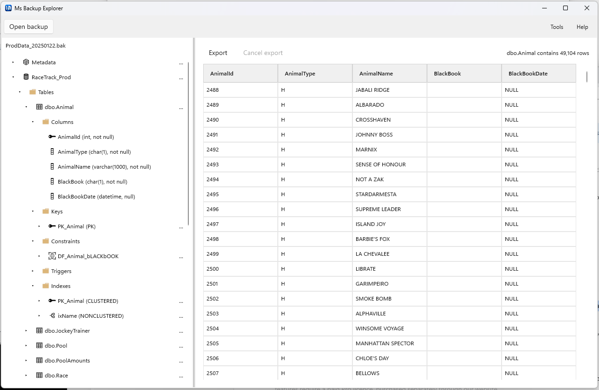
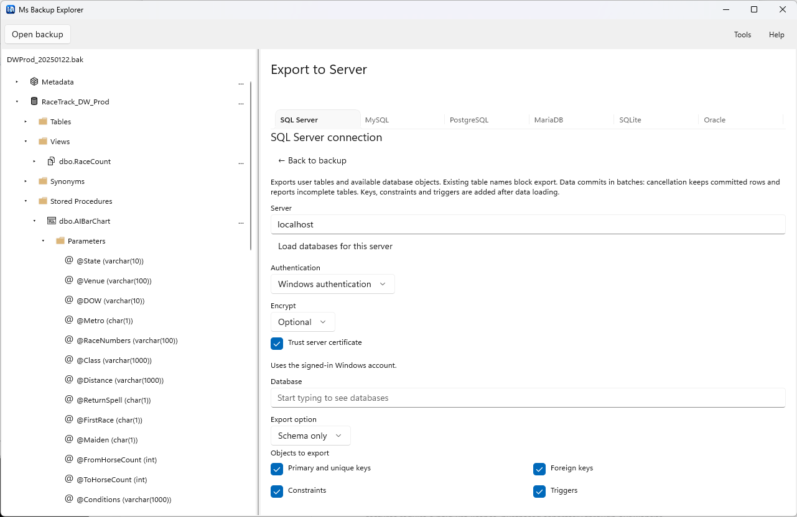
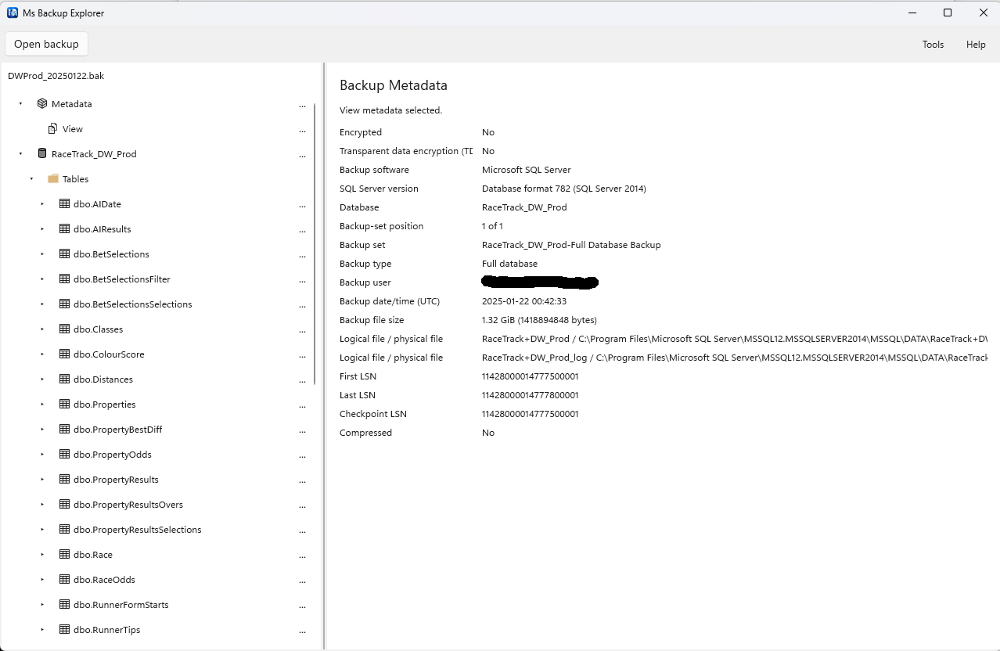
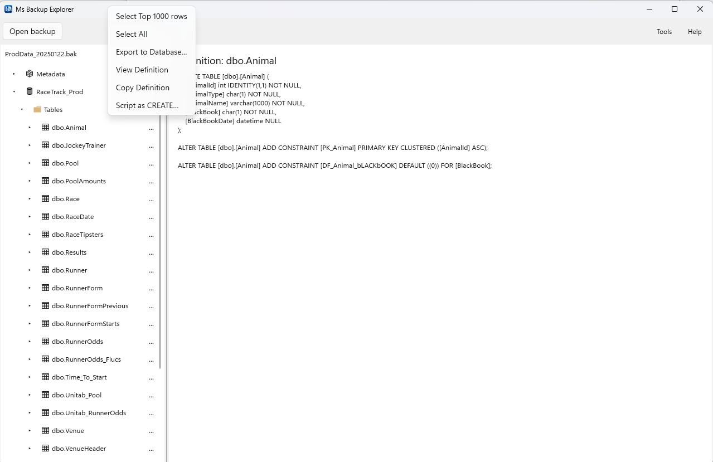
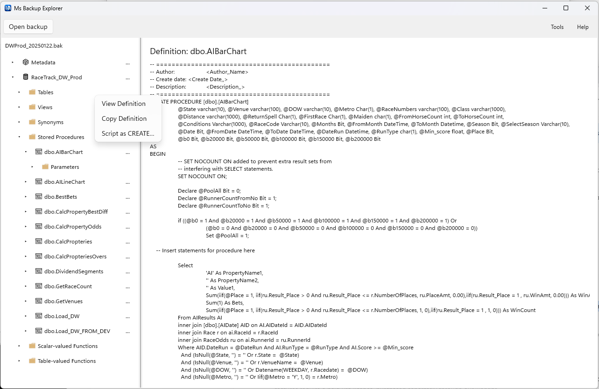

# MSBackupExplorer
MSBackupExplorer lets you explore SQL Server backups, inspect data and recover the information you need—without installing or running SQL Server.

Save time by opening a backup directly instead of restoring an entire database just to find a record, inspect a table or recover selected data.

## Key features

-  Browse tables, records, views, stored procedures and other supported SQL objects.
- Work with supported compressed, encrypted and striped SQL Server backups.
- Support for database row, page and column compression.
- Export a single table to a supported database platform or CSV.
- Export to SQL Server, MySQL, PostgreSQL, MariaDB, SQLite and Oracle.
- Export supported SQL Server objects, including procedures, functions, views, triggers and synonyms.
- Analyse damaged backups and attempt to recover readable data. Where the database catalogue is corrupted, a compatible working backup can be used as a reference.
 - Cross-database exports support tables, data, primary keys and foreign keys. Other SQL objects are supported when exporting to SQL Server.
 - Filter, Sort, select Columns and Export your data

## Download

[Download from GitHub](https://github.com/Gus-van-Diermen/MSBackupExplorer/releases/latest)

[Get it from Microsoft Store](https://apps.microsoft.com/detail/9NLNM26LVD33)

[Download from our website](https://www.msbackupexplorer.com/download)
   
## Free and Pro

The **Free edition** lets you explore supported backups and
preview up to **100 rows per table**.

**Pro** adds export and recovery output features.

[View pricing](https://www.msbackupexplorer.com/#pricing)

Backup contents are processed locally. 

Encrypted backups require the appropriate passwords, certificates or keys. 

Supported features depend on the backup format and contents; recovery of damaged backups cannot be guaranteed.

Requires a 64-bit Intel or AMD system running Windows 10 version 1809 or later, Windows 11, or Windows Server 2019 or later with Desktop Experience.

## Screenshots

### Explore a backup

### Export selected data

### Browse Backup MetaData

### View and Export Table Definitons

### View and Export Stored Procedure definitions and any other type of SQL Server Object

